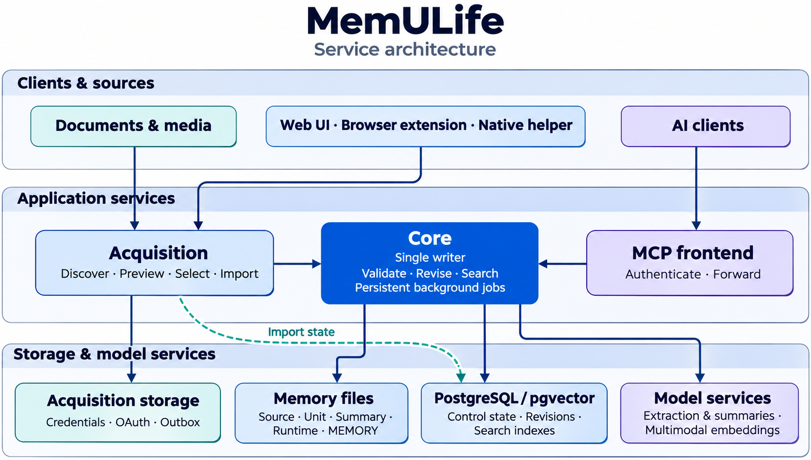

# MemULife

为你和 AI 整理长期记忆：把文档、对话与媒体转成带证据的事件，按日期和主题组织，并通过管理页面与 MCP 随时查阅、补充和修订。

## Quick Start

准备 Docker Engine、Docker Compose 2.20.2+、Python 3，以及可访问的记忆模型与向量模型服务。在项目根目录执行：

```bash
python3 ops/bootstrap.py
```

打开生成的 `.env`，填写 `MLLM_BASE_URL`、`MLLM_MODEL_NAME`、`EMB_BASE_URL`、`EMB_MODEL_NAME` 和 `EMB_MODEL_REVISION`，按服务要求填写 API Key。模型在宿主机运行时，容器可通过 `host.docker.internal` 访问；模型服务需要监听容器可达的接口。

默认后端为 `MLLM_PROTOCOL=llamacpp` 和 `EMB_BACKEND=vllm_gemma`。记忆模型需要支持结构化任务输出，向量模型的版本用于区分向量空间。其他后端及接口要求见 [模型配置](docs/quick-start.md#模型接口)。

```bash
docker compose config --quiet
docker compose up -d --build --wait --wait-timeout 1200
```

| 入口 | 地址 | 认证 |
|---|---|---|
| 管理页面 | [http://127.0.0.1:5073/manage/imports](http://127.0.0.1:5073/manage/imports) | 使用 `.env` 中的 `MEMU_OWNER_TOKEN` 登录 |
| MCP | `http://127.0.0.1:5071/mcp` | 使用 `MEMU_AGENT_TOKEN`，对应身份 `agent1` |

在管理页添加一个来源，预览并选择内容后开始导入。处理进度显示在导入记录中，生成的记忆可以在“记忆管理”查看。

本地文件需要挂载到采集容器后再选择。完整步骤见 [Quick Start](docs/quick-start.md)；k3s、反向代理与远端 MCP 部署见 [部署指南](deploy/README.md)。

## Project Introduction

MemULife 把零散材料组织成能持续更新、回到原文核对的记忆。一次会话里的决定、一份文档中的结论、某个项目的阶段进展，可以被关联起来，而不必在每次对话时重新提供全部上下文。

### 三层记忆与全局入口

记忆由 **Unit 事件层、Summary 时间汇总层、Runtime 主题层**构成。`MEMORY` 是全局导航入口，帮助模型找到相关主题和时间范围，再逐层读取细节。

| 组成 | 保存什么、解决什么问题 | 从哪里生成 |
|---|---|---|
| **Unit · 事件记忆** | 可独立理解的目标、行动、决定、结果或未决问题，附时间、证据和关联。回答“具体发生了什么”。 | 从选定的 Source 提取；长文本和媒体可先经过 Detail 中间整理，再提取事件。 |
| **Summary · 日/月汇总** | 按事项归纳一天的行动，或一个月的阶段进展。回答“这段时间做了什么”。 | 日汇总来自当天的 Unit；月汇总综合日汇总的证据，并补充只有月份信息或尚未覆盖的 Unit。 |
| **Runtime · 主题记忆** | 围绕项目、长期目标或关注方向，组织当前状态、进展、约定与待办。回答“这个主题现在怎么样”。管理页称为“记忆主题”。 | 来自属于该主题的 Unit。主题可自动发现，也可由用户指定名称与关注范围。 |
| **MEMORY · 全局导航** | 提供整体概览以及主题、月度汇总等读取入口，帮助模型决定下一步查哪里。 | 综合有效 Runtime 与尚未被主题覆盖的 Unit，并附主题和月汇总目录。 |

Summary 和 Runtime 分别从时间与主题角度组织事件，同一条 Unit 可以出现在日汇总和对应主题中。Runtime 指主题记忆，并非程序运行日志。

**Source 是这些记忆的证据基础。** 它保存选中的原始文字、附件或来源引用；Detail 是按需生成的中间整理结果。模型可以沿着 `MEMORY → Runtime / Summary → Unit → Source / 媒体` 逐步了解背景、定位事件并核对依据。文件保留原件附件，对话保留角色和顺序，媒体可定位到资源或时间片段。

### 记忆如何持续维护

导入的素材先持久保存，再由后台提取 Unit、建立索引、更新汇总和主题。连接成功、素材已接收、记忆已生成是不同状态，页面和 MCP 可以查询处理进度。

管理页和外部模型共用修订事务：校验目标版本、精确原文与新增引用后提交，保留修改历史。手动修订默认受保护，后续自动整理保留这些内容。编辑和删除保持其他记忆的定位符与行号稳定，相关索引和汇总由后台维护。

## 数据来源与扩展

### 数据来源

| 来源 | 可导入内容 | 使用方式 |
|---|---|---|
| 文件与笔记 | 文本、代码、HTML、PDF、DOCX、XLSX、PPTX，以及图片、音频、视频等附件 | 挂载或配置目录，浏览文件树并选择文件；可读格式提取正文，其他格式保留附件。 |
| Notion | 已授权的页面、数据库及其内容 | 配置连接后浏览层级、预览并选择对象。 |
| 飞书 | 授权范围内的文档与知识库内容 | 配置应用并完成用户授权，然后选择文档或知识库范围。 |
| Immich | 相册、照片、视频及相关描述和时间信息 | 按相册或日期选择资产，保存来源引用，按需展示缩略图并打开原站资源。 |
| 网页 AI 会话 | ChatGPT、Claude、Gemini、Perplexity、DeepSeek、Grok | 浏览器连接器提供会话目录和选定内容，由管理页面控制导入范围。 |
| 本地 AI 日志 | Codex、Claude Code、Gemini CLI、OpenCode、Cursor | 选择客户端日志目录、文件或数据库，按原始角色与事件整理。 |
| 录屏材料 | 原生助手提供的屏幕片段与关联事件 | 配合 Windows 或 Wayland 原生助手使用，按选定范围交付素材。 |

各来源的发现、预览、时间筛选和附件能力取决于对应适配器与授权范围。具体配置见 [采集端指南](docs/acquisition.md)。

### 浏览器与原生扩展

[浏览器连接器](browser-extension/README.md) 在浏览器环境中读取已授权的网页 AI 会话，配合管理页完成账号连接、会话选择和内容交付。普通网页配对通过本地 HTTP 服务完成；Native Messaging 可作为另一种连接方式。

[Windows 原生助手](native/windows) 和 [Wayland 原生助手](native/wayland) 提供录屏材料采集能力，需要在对应桌面环境安装和配置。

### 添加新的数据来源

来源能力与记忆处理流水线分开实现。新增来源通常包括：

1. 在 [`sources/`](memu/acquisition/sources) 实现 `SourceModule`，定义配置、发现、预览、选择范围与导入计划。
2. 在 [`adapters/`](memu/acquisition/adapters) 实现读取器，提供连接探测、分页读取、健康检查和附件获取，返回统一的 `Snapshot` / `Page`。
3. 在 [来源注册表](memu/acquisition/sources/registry.py) 注册模块，复用已有文件、文档、会话或媒体页面。

适配器交付选定材料，核心负责持久化、记忆生成和检索。读取游标在对应材料确认交接后推进，支持断点续传与幂等处理。

## 服务架构



| 服务 | 职责 |
|---|---|
| **Acquisition · 采集与管理** | 提供管理页面、来源连接、预览、内容选择和导入任务；保存来源授权、OAuth 状态与待交付材料。采集任务状态进入 PostgreSQL。 |
| **MCP frontend · 模型入口** | 处理认证和 MCP 协议，把工具调用转发给核心。服务无状态，可与核心分别部署。 |
| **Core · 记忆核心** | 单写入者，统一执行提取、修订、检索、引用校验和事务提交；调度持久化的后台任务。 |
| **记忆文件 + PostgreSQL / pgvector** | 文件保存正文与附件；数据库保存权威控制状态、任务、修订历史以及文本、关系和向量索引。 |
| **模型服务** | 记忆模型负责提取、归纳和主题整理；向量模型编码文字与支持的媒体，用于语义召回。 |

Compose 负责数据库初始化和服务依赖顺序。同一仓库保持一个核心写入者；MCP 可独立扩容。备份与恢复需配套处理数据库、记忆卷和采集卷。详细流程见 [项目设计](docs/project-overview.md) 与 [架构说明](docs/architecture-review.md)。

## 如何使用

### 在管理页面整理记忆

1. **导入**：添加来源，浏览和预览内容，明确选择对象及日期范围后提交。导入记录显示任务进度和结果。
2. **查看**：按来源查看 Unit 和 Source，按日期与原导入格式筛选；在日/月 Summary 中回顾时间线，在“记忆主题”中查看长期进展。
3. **搜索**：输入连续文字，在 Unit、Source、Summary 和记忆主题中选择搜索范围。页面使用精确文字匹配。
4. **修订**：打开 Unit、日/月 Summary 或主题条目进行编辑，保存后内容受保护。删除 Unit 或 Source 时先查看关联影响，再确认操作；后台继续更新受影响的汇总与索引。

### 连接 MCP

在支持 Streamable HTTP 的客户端中配置：

```json
{
  "mcpServers": {
    "MemULife": {
      "url": "http://127.0.0.1:5071/mcp",
      "headers": {
        "Authorization": "Bearer <MEMU_AGENT_TOKEN>"
      }
    }
  }
}
```

将占位符替换为 `.env` 中的实际值；远端部署使用对应 HTTPS 地址。工具参数中的 `from` 必须与 token 身份一致，默认客户端身份为 `agent1`。

| 工具 | 用途 |
|---|---|
| `memory_read` | 读取概览、条目、原文行段和媒体；可查看关系邻居、编辑版本和修订历史。 |
| `memory_search` | 通过精确文字或语义、多模态查询寻找候选记忆。 |
| `memory_write` | 用户授权后追加材料，或原子修订 Unit、日/月 Summary 和 Runtime。 |
| `memory_status` | 使用 `request_id` 或原幂等键查看提交状态。 |

外部模型修订前先读取目标的 `edit_revision`，提交精确的 `old_text`、`new_text`、理由和幂等键；新增引用由核心校验。完整参数见 [记忆修订协议](docs/memory-revisions.md)。

### MCP 的搜索逻辑

MCP 向调用模型提供检索工具和使用指引，由模型根据问题选择读取与搜索步骤。

1. **先定位范围。** 需要整体背景时读取 `MEMORY`，再进入相关 Runtime 或时间汇总；已经有定位符时直接读取目标。
2. **有明确文字，用 `grep`。** 名称、原话、错误信息等适合连续文字匹配，可通过 `layers` 限定类型，或用 `scope` 限定来源、主题、日期目录。
3. **只有含义或媒体线索，用 `semantic`。** 查询可以是文字、已有记忆引用 `query_refs`，或图片、音频、视频 `query_media`。返回相关 Unit 和可继续读取的媒体入口。
4. **沿证据和关系继续读。** 读取命中的 Unit，再核对其 Source、附件或媒体。需要上下文时，`memory_read` 的 `links`、`relations`、`direction`、`hops` 可扩展关系邻居。
5. **信息不足时扩大范围。** 尝试别名、调整词语、放宽筛选或读取下一页，依据实际正文和证据回答。

读取入口：

```json
{"from": "agent1", "refs": ["MEMORY"]}
```

查找明确文字，调用 `memory_search`：

```json
{"from": "agent1", "method": "grep", "query": "发布计划", "layers": ["unit", "runtime"], "limit": 10}
```

按含义查找，调用 `memory_search`：

```json
{"from": "agent1", "method": "semantic", "query": "上次部署遇到了什么问题，最后如何处理？", "limit": 10}
```

`grep` 区分大小写，不做模糊匹配；`semantic` 查询 Unit 与原生媒体索引，可组合多路向量候选并融合排序。语义命中是相关候选，仍需读取正文核对。结果受 `limit` 与 `budget_chars` 控制，有下一页时使用返回的 `cursor` 继续读取。空仓库或后台尚未完成整理时，`MEMORY` 入口可能尚未生成。

更多实现细节见 [项目介绍](docs/project-overview.md)、[核心设计原则](docs/core-design-principles.md) 和 [可靠写入与恢复](docs/reliability.md)。
