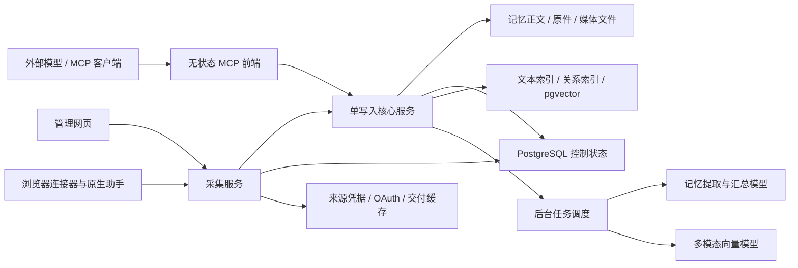
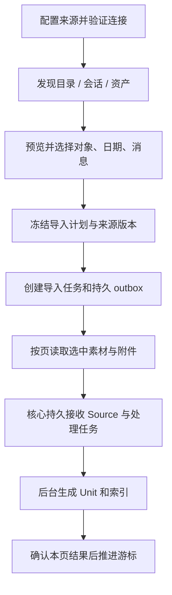
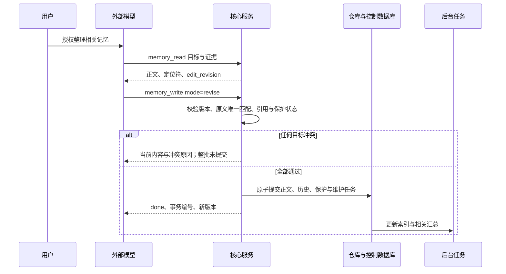

# MemULife 项目介绍与实现流程

本文说明项目的主要功能、数据组织、服务边界和实现流程。以当前仓库代码为依据；部署模板代表可选方案，不能替代目标环境的实际验收。

后续设计、开发、维护和评审须遵守[核心设计原则](core-design-principles.md)。

## 1. 项目解决什么问题

MemULife 将分散在文档、AI 对话、工作日志和媒体中的信息，整理为可追溯、可查询、可维护的个人记忆。用户可以先选择要导入的内容，再查看原始来源、提取出的事件、按日期生成的汇总，以及跨日期组织的主题记忆。外部模型通过 MCP 读取这些记忆，也可以在用户授权后修订已有内容。

系统同时保存“发生了什么”和“依据在哪里”。来源原文、事件记忆、汇总视图分层存放：汇总用于快速了解整体，Unit 保留具体事件，Source 和媒体用于回到证据。自动整理和外部修订均须通过程序校验，模型不直接执行数据库语句或修改仓库文件。

## 2. 主要功能

| 功能 | 用户可以做什么 | 实现入口 |
|---|---|---|
| 来源接入与选择 | 配置来源、浏览候选、预览内容、选择日期与具体对象后导入 | `memu/acquisition/` |
| AI 对话导入 | 导入网页会话和本地客户端日志，保留角色、轮次及证据 | `acquisition/sources/`、`browser-extension/` |
| 文档与媒体导入 | 导入文件、云文档和相册信息，查看原件附件或受控媒体预览 | `acquisition/adapters/`、`attachments.py`、`media_browsing.py` |
| 事件记忆提取 | 从选中的材料提取目标、行动、结果、未决问题及来源引用 | `ingestion.py`、`tasks/` |
| 长内容处理 | 分批处理长对话，使用滚动上下文并保留阶段检查点 | `batching.py`、`compaction.py` |
| 日/月 Summary | 按事件日期查看当天事项与月度进展 | `service.py` 中的视图维护 |
| 记忆主题 | 自动发现跨来源主题，或由用户指定主题和关注范围 | `topics.py` |
| 文本与多模态检索 | 按连续文字查找，或用语义、图片、音频、视频寻找相关 Unit | `index.py`、`indexing.py`、模型适配器 |
| 记忆管理页面 | 浏览 Unit/Source、日期与格式筛选、看详情、搜索、编辑保护和删除 | `acquisition/ui/memory.js`、`browsing.py` |
| 外部模型修订 | 精确修改 Unit、日/月汇总或主题条目，保留定位符、历史和受保护内容 | `revisions.py`、`revision_storage.py` |
| 异步维护与恢复 | 持久接收后后台处理，查看状态，恢复断点和失败任务 | `worker.py`、`retry.py`、`postgres_repository.py` |

## 3. 整体架构

系统有三个应用进程：

- **采集服务**：提供管理网页、来源配置、授权、内容选择、预览、导入任务与附件展示。采集任务状态存入 PostgreSQL，来源凭据和交付缓存位于独立私有卷；通过核心 API 交接素材，不自行生成最终记忆。
- **MCP 前端**：验证请求身份与入口策略，将工具调用转发给核心。前端不打开记忆目录、不连接数据库、不加载模型，可与核心分机部署，也可运行多个副本。
- **核心服务**：拥有记忆仓库写入权，负责数据校验、事务、事件提取、主题与汇总维护、检索和修订历史。同一仓库只运行一个核心写入者。

默认端口分别为采集服务 `5073`、核心 `5072`、MCP `5071`，可通过配置修改。外部访问可以经过 HTTPS 反向代理，前端与核心通过受保护的私网连接。

## 4. 记忆如何组织

面向使用者的记忆分为 Unit 事件层、Summary 时间汇总层和 Runtime 主题层，MEMORY 提供全局导航。Source、Detail 和媒体承担证据保存与中间处理。下表列出这些组成的作用和定位方式。

| 层次 | 内容与作用 | 定位方式 |
|---|---|---|
| Source | 被选中并持久保存的来源材料；原始审计及附件另有保留机制 | `c12:3-18` 等行段 |
| Detail | 长文本或媒体的中间整理结果，继续引用原始证据 | `s8:2-5` 等行段 |
| Unit | 可独立理解的事件：正文、时间、主题、证据与关系 | `u12:3` 等记录起始行 |
| 日/月 Summary | 从 Unit 汇总出的事项和阶段进展 | 视图入口，按日期范围浏览 |
| Runtime | 围绕同一主题组织的跨日期记忆；页面称“记忆主题” | `r5` 入口及独立 `entry_id` |
| MEMORY | 全局概览，帮助模型找到相关主题与进一步读取的入口 | `MEMORY` |
| 原生媒体 | 图片、音频、视频及可引用的时间片段 | 媒体入口或 `a9@12.4-18.0` |

这里的 Runtime 是主题记忆视图，不是进程运行日志。时间记录保留已知精度：具体时刻、日期、月份、年份、范围或未知，不将不确定日期伪造成精确日期。

Unit 的 `facts` 表示证据，`relations` 表示与其他 Unit 的语义联系。当前关系词表包括延续、补充、回应、更正、同一事件、因于和相关。程序分别校验两种引用，不把关联记忆自动当成原始证据。

正文文件与 PostgreSQL 控制状态共同组成可恢复的仓库。正文和原件保存在文件中；目录、任务、删除标记、修订历史等权威控制数据保存在 PostgreSQL。文本、关系和向量检索表是派生索引。备份需要完整记忆目录与数据库，不能只复制 Markdown。

## 5. 来源接入与导入流程

### 5.1 来源能力

| 来源 | 接入与读取方式 | 导入边界 |
|---|---|---|
| 本地文件与笔记 | 配置采集服务可访问的根目录，浏览文件树并冻结选中文件版本 | 只读取选中文件；提取可读内容，保留原件附件 |
| Notion | 配置连接凭据，发现已授权页面/数据库，在正文区域浏览层级并预览 | 只处理 API 身份可见且用户选中的对象 |
| 飞书 | 应用配置与用户授权结合，完成授权回调后浏览可访问文档和知识库 | 根据授权权限及用户选择读取；凭证交换与刷新由服务端负责 |
| Immich | 连接相册服务，选择资产与时间范围 | 保存资产引用；按需获取缩略图，原件保留在来源平台 |
| 网页 AI | 浏览器连接器发现账号与会话目录，用户选择后读取会话 | 支持 ChatGPT、Claude、Gemini、Perplexity、DeepSeek、Grok 的适配配置 |
| 本地 AI 日志 | 读取用户明确选择的日志目录、文件或数据库 | 支持 Codex、Claude Code、Gemini CLI、OpenCode、Cursor |
| 原生录屏 | 原生助手提供受选范围内的录屏材料 | 助手与运行环境需分别安装、配置并验证 |

来源适配器由静态注册表选择。来源配置是数据，不能指定任意 Python 模块或命令来执行。读取器在当前 Python 环境的独立子进程中工作，并受路径、响应大小和时间范围约束。

### 5.2 从选择到入库

发现和预览使用有界临时缓存；只有提交选定计划后，素材才进入持久导入流程。任务保存原始材料、游标和幂等键，断线后可以继续原任务。未知写入结果不会通过换键重发来“猜测恢复”。

持续更新建立在已完成的一次性导入之上，沿用原先选择范围。订阅不会擅自把新文件或新会话加入范围；有风险的失败暂停等待处理。轮询间隔最低为 150 秒。

### 5.3 对话、附件与无效材料

本地 AI 日志先被解释为带角色的事件：用户原话、助手报告、工具调用、工具结果、自动上下文分别处理。工具调用不能证明执行成功；助手报告不能自动变成已独立验证的事实。自动重放、上下文压缩、空审计占位等不产生有效事件时，不作为普通记忆显示或提取。

有真实附件的记录仍保留。管理页面可以把文件 Source 展示为原件附件，而不必展开为解析后的碎片。内部提取可使用文件解析结果，展示与记忆提取各自遵循用途。媒体预览通过已认证的服务端接口解析来源，不接受浏览器直接提供任意本地路径或凭据。

## 6. 新记忆如何生成

正常写入使用 `memory_write(mode="ingest")`，也可通过认证的 HTTP 写入入口提交。

1. **接收与过滤**：校验身份、时间、素材和幂等键，过滤无有效内容的占位材料，保存 Source、附件及 queued 任务。
2. **快速返回**：返回 `accepted` 与 `request_id`，表示已经持久接收，尚未完成整理。
3. **中间整理**：按需要对长文本和多模态材料生成 Detail。长内容分批处理，不通过直接截掉原件来适配模型上下文。
4. **提取 Unit**：模型输出结构化事件及引用；程序验证字段、证据范围、角色和覆盖关系。本地 AI 的同一真实用户轮次通过专门流程归并，避免每个工具消息形成一条成果。
5. **生成向量与关联**：编码 Unit 和可用的原生媒体，召回相关候选；普通记忆按受限关系词表生成联系，会话延续可按顺序直接建立。
6. **提交与维护**：提交 Unit、关系和任务检查点；更新索引并安排日/月、主题及全局概览的后台任务。

滚动压缩保留上一批的工作上下文和少量相关旧条目，要求模型注明新输入已被哪些条目覆盖。原始 Source 与完整条目账本继续保留，不依赖压缩上下文本身充当唯一记录。模型输出截断时可拆分批次；成功阶段保存检查点，恢复时复用。

`done` 表示该写入的内容提交完成；索引和汇总是否就绪另行标明。索引暂不可用不会让服务重新生成已完成的 Unit。

## 7. 日/月汇总与主题记忆

**日汇总**按事项组织当天的行动和结果；**月汇总**优先使用日汇总保留的证据，归纳阶段进展和未决问题，同时补充只有月份信息或日汇总未覆盖的 Unit。汇总条目保留 Unit 引用，具体参数和执行细节继续留在 Unit 或 Source。

**自动主题**由独立任务跨记录发现。默认需要至少两个独立来源和两个事件日期，避免把一次对话里出现的名称直接发布为长期主题。同一对象的重复导入不算多个独立来源。

**用户主题**由用户指定名称和关注范围，建立后可以归入历史和未来的相关 Unit。外部修订通过 `add_topics` 设置的明确归属会被单独保留，自动分类不能撤销；删除 Unit 后不会因这种归属让它重新出现。

主题 Runtime 汇总对应 Unit，MEMORY 组织主题入口与尚未被主题覆盖的记忆。汇总任务记录 generation 和输入 revision；如果模型计算期间输入发生变化，旧提案不能直接覆盖较新的状态。

## 8. 查询与管理页面

MCP 的常见读取顺序为 `MEMORY → Runtime → Unit → Source/媒体`。已有稳定定位符时直接读取，不需要重复搜索。`memory_read` 提供正文、版本、待更新状态、可选关系邻居和分页；读取媒体返回可继续获取的资源入口。

- **文字检索**：`memory_search(method="grep")` 使用连续文字匹配，可按层次和范围限制。数据库使用文本索引加速。
- **语义检索**：`method="semantic"` 编码文字、媒体或已有引用，查询向量候选并融合排序，返回可进一步读取的 Unit 和媒体入口。结果是有界候选，不保证枚举全部相关记忆。
- **关系检索**：沿指定关系、方向和跳数查找邻居。关系不会使其他 Unit 自动继承无关媒体证据。

管理网页分为“记忆导入”和“记忆管理”。导入区管理连接、选择和任务；管理区按来源浏览 Unit/Source，提供原导入格式、日期、连接筛选，日/月 Summary 和记忆主题入口，以及文字搜索。

列表采用随页面宽度变化的卡片布局，宽屏显示两列，窄屏回落单列。Unit 列表突出内容，ID、证据、账户等信息放在详情；对话 Source 按角色和消息顺序展示，普通文件可显示原件附件。搜索范围中的“记忆主题”对应内部 Runtime。

删除 Unit/Source 时先计算影响范围，再提交删除并把重建放入后台队列。直接关联的来源片段和共用证据的其他记忆可能一并受影响，确认界面显示实际数量。正文采用原位清空与墓碑记录，保留后续行号；相关旧汇总立即停止作为正常有效视图使用，后台重建。来源平台上的原件不通过此操作删除。

## 9. 外部模型如何修订已有记忆

这条流程让上下文更完整的外部模型直接提交最终改稿。例如用户说明两个实验属于同一主题，模型可以为对应 Unit 补充项目归属、添加另一个 Unit 的关系，并让后台重新组织主题视图。

每次修改提供目标、原样摘录、替换文本、目标版本、理由和幂等键。摘录不必是全文，但必须精确出现一次。新增证据必须存在，Unit 关系目标必须是有效 Unit。程序可以验证引用存在，不能据此自动证明结论真实；外部模型仍需阅读证据并区分事实与推断。

Unit 修订通过单行编码存储可包含换行的正文，原记录多余物理行留空，保持原始 Unit 定位符和其他记录位置。修改前后内容、调用身份、原因和事务编号进入显式历史；恢复旧内容也产生新版本，不抹除历史。

日/月 Summary 与 Runtime 为每条内容分配稳定 `entry_id`。管理页面与外部模型使用同一修订事务；Unit 和视图修订默认保护正文与引用，自动汇总或重新导入不能覆盖。再次手动编辑使用 `allow_protected=true` 并通过版本检查，仍保持保护；只有 `protect=false` 明确解除保护。证据删除后，受保护正文保留，并标出失效引用；失效内容不进入新的有效汇总依据。

直接修订不再调用内部模型解释改稿。提交成功后，受影响 Unit 的向量、文字和关系索引，以及相关汇总在后台更新。具体请求、返回和约束见 [记忆修订协议](memory-revisions.md)。

## 10. 一致性、权限与运行维护

### 10.1 文件与数据库提交

核心先将待发布文件写入暂存区并落盘，再在一个 SQL 事务中提交目录、任务、历史和文件发布意图，最后发布正式文件。发生中断时依据发布日志恢复，不重新调用模型生成同一份内容。无法确认提交结果时保留暂存字节与幂等信息。

索引读取变更文件快照，生成或复用向量，再发布派生记录。发布完成时校验当前 revision、目录状态与删除 epoch；过期快照不能清除后续变更的待同步标记。修订会使目标 Unit 的旧向量失效，其他 Unit 可以继续复用缓存。

### 10.2 权限边界

每个请求携带身份 token；工具参数中的 `from` 必须匹配认证身份。核心检查读写白名单，管理操作另要求 owner 身份。当前是一个共享仓库内的身份权限体系，不是按来源划分的多租户隔离产品。

`MEMU_MCP_WRITE_ENABLED=false` 可隐藏并拒绝外部写入，私网核心和采集流程的授权独立处理。外部模型不能通过 MCP 传入内部投影替换元数据、文件路径或 SQL。开发日志只记录阶段、状态和安全错误码，避免输出素材和凭据。

### 10.3 后台调度

核心分别限制记忆模型与向量模型并发。模型推理期间释放提交锁，提交前重新校验输入。独立索引发布器合并变更；来源积压较高时优先持久接收素材。日常刷新、主题发现、失败退避和重试检查点均保存在控制库中。

未知结果通过原幂等键查询或重试，不能换键后自动重放。关闭核心时等待已启动任务完成；只重启 MCP 不会停止核心后台工作。健康检查、工具发现通过，不等于所有外部来源、媒体格式和真实模型效果都已验收。

## 11. 代码导航与运行入口

| 目录/文件 | 主要职责 |
|---|---|
| `memu/cli.py` | 初始化、启动 core/MCP/acquisition、采集及检查命令 |
| `memu/config.py`、`environment.py` | 类型化配置、环境解析与访问策略 |
| `memu/mcp.py`、`http_server.py` | MCP 协议、前端请求与入口开关 |
| `memu/core_api.py`、`operations.py` | 核心 HTTP API、工具参数契约 |
| `memu/ingestion.py`、`memulife.py` | 素材接收、导入转换与记忆处理流水线 |
| `memu/tasks/` | 结构化模型任务、提示词、输出与证据校验 |
| `memu/topics.py`、`service.py` | 主题发现、汇总、读取、删除和调度协作 |
| `memu/revisions.py`、`revision_storage.py` | 精确修订、历史、稳定记录与手动内容保护 |
| `memu/storage.py`、`postgres_repository.py`、`control.py` | 文件记录、SQL 控制状态、事务与恢复 |
| `memu/index.py`、`indexing.py` | 文本/关系/向量查询与增量发布 |
| `memu/models.py`、`vllm_embedding.py`、`gemma_embedding.py` | 模型网关与向量后端适配 |
| `memu/acquisition/` | 来源接入、选择、授权、导入任务和管理网页 |
| `browser-extension/`、`native/` | 浏览器连接器与原生采集助手 |
| `deploy/`、`ops/` | 部署模板、服务运维和公开包生成 |
| `tests/` | 合成数据、隔离数据库及各边界的针对性检查 |

运行需要 Python 3.11+、专用 PostgreSQL 与相应扩展、配置好的记忆模型和向量后端；处理音视频还需要 FFmpeg/FFprobe。服务分别用 `python -m memu core`、`python -m memu mcp`、`python -m memu acquisition` 启动。

进一步阅读：[项目 README](../README.md)、[可靠写入与恢复](reliability.md)、[采集端指南](acquisition.md)、[本地 AI 内容规则](local-ai-content.md)、[部署说明](../deploy/README.md)、[远端 MCP 部署](../deploy/remote-mcp/README.md)。
